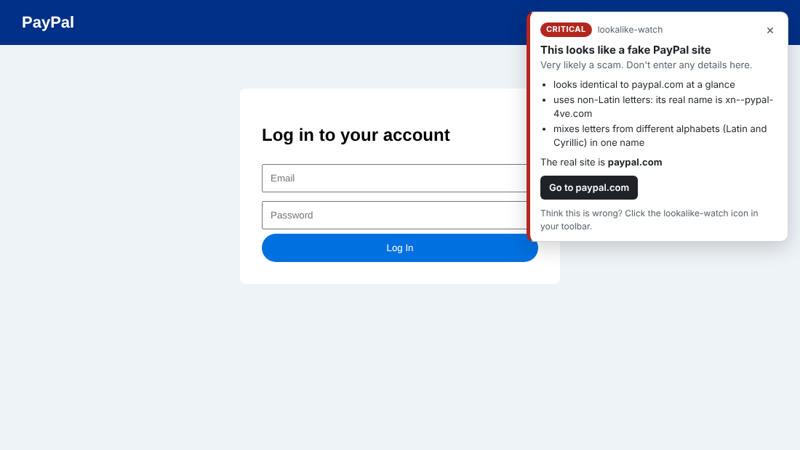
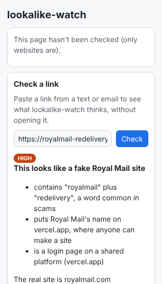

# lookalike-watch

[](https://github.com/CERTIFIED228/lookalike-watch/actions/workflows/ci.yml)


A browser extension that warns you when the website you're on is a fake copy of a real one, and a scanner that finds those fake sites as soon as they're registered.

<p align="center">
  
  &nbsp;
  
</p>

## Why I made it

Most online scams start with a website that looks right at a glance: `paypa1.com` instead of `paypal.com`, a Royal Mail "redelivery" page, an HMRC "tax refund" site. If you grew up online you learn to spot most of them. A lot of older people didn't, and the internet they first learned on didn't have parcel texts with links in them, fake login pages that copy a bank down to the logo, or web addresses with a Cyrillic "а" that looks exactly like an "a". Scammers know that.

I wanted something that does the spotting for them, and says in plain words what's wrong and how serious it is, before they type in a password or card number.

## Download and try it

### The browser extension (Chrome or Edge)

1. [Download lookalike-watch-extension.zip](https://github.com/CERTIFIED228/lookalike-watch/releases/latest/download/lookalike-watch-extension.zip) and unzip it (on Windows: right-click it, then **Extract All**).
2. In Chrome go to `chrome://extensions` (in Edge, `edge://extensions`) and switch on **Developer mode**.
3. Click **Load unpacked** and choose the folder you just unzipped.
4. Click the puzzle-piece icon in the toolbar and pin **lookalike-watch** so you can see its badge.

To check it's working, click its icon and paste `paypa1.com` into **Check a link**. It should say CRITICAL. After that, just browse as normal: nothing shows up unless a site looks wrong. The phishing lists download by themselves the first time, which takes about 30 seconds.

It isn't on the Chrome Web Store, which is why Chrome needs Developer mode to load it. Chrome also says it can "read and change all your data on all websites". That's because it has to run on every page to check it. It only looks at the address and whether the page has a login form, and nothing is ever sent anywhere: the only things it downloads are the two public phishing lists.

### The scanner (Python 3.10 or newer)

```bash
pip install https://github.com/CERTIFIED228/lookalike-watch/releases/download/v0.1.0/lookalike_watch-0.1.0-py3-none-any.whl
lookalike-watch scan paypal.com --nameserver 1.1.1.1
```

On Windows, if `lookalike-watch` isn't recognised, run `python -m lookalike_watch` instead. Every version is on the [releases page](https://github.com/CERTIFIED228/lookalike-watch/releases).

## What it does

**The extension** protects the person about to type their password. On every page it checks whether the site is:

- a lookalike of a site worth protecting: 43 often-phished brands (banks, PayPal, Amazon, Royal Mail, HMRC, the NHS...), the 10,000 most visited sites, and any site you log into regularly;
- on a list of about 390,000 known phishing sites;
- showing the warning signs of a fake login page, like a password form on a raw IP address.

If something's wrong it shows a warning on the page with how serious it is (low to critical) and the reasons, plus a button to go to the real site.

**The scanner** works from the brand's side. Give it a domain like `paypal.com` and it:

1. **Generates lookalikes** of a domain using 12 techniques (typos, homoglyphs, bit flips, TLD swaps, brand + keyword combos...).
2. **Checks which ones exist** with parallel DNS lookups (NS, A/AAAA, MX).
3. **Searches Certificate Transparency logs** (via [crt.sh](https://crt.sh)) for any certificate with the brand name in it. This catches things like `paypal-account-review.com` that no typo generator would ever come up with.
4. **Scores each registered domain 0-100** and lists the reasons behind the score.
5. **Watch mode** re-scans on a schedule and posts *new* findings to Slack or Discord.

It never visits the suspicious sites. Everything comes from DNS and public certificate logs.

## How the extension works

### What it checks

Every page is checked in the browser itself. The sites you visit are never sent anywhere.

1. **Lookalikes of sites worth protecting**: 43 often-phished brands (Microsoft, PayPal, Amazon, UK banks, Royal Mail, Evri, HMRC, DVLA, NHS...), the ~8,300 domains behind Chrome's 10,000 most visited sites, and any site you've logged into on two different days. It catches:
   - homoglyphs (`pаypal.com` with a Cyrillic а, `paypa1.com`, `1cloud.com`)
   - one-letter typos of the protected brands and your sites (`paypl.com`)
   - brand + scam word (`paypal-login.com`, `hmrc-tax-refund.com`, `royalmail-redelivery.com`)
   - a real domain used as a fake subdomain (`paypal.com.secure-check.bid`)
   - a brand in the subdomain of an unrelated site (`paypal-login.secure-host.net`)
   - brand names on services where anyone can get a subdomain (`royalmail-redelivery.vercel.app`, `paypal-verify.wordpress.com`, `hmrc-refund.co.com`). The list of those services is the private part of the [Public Suffix List](https://publicsuffix.org/), about 2,900 of them, plus about 30 that phishers use a lot but aren't on it (wordpress.com, sharepoint.com, wpengine, weebly...).
2. **Known phishing sites**: [Phishing.Database](https://github.com/mitchellkrogza/Phishing.Database) (about 390,000 active domains) and the [OpenPhish](https://github.com/openphish/public_feed) public feed. Both are downloaded every 6 hours, stored in IndexedDB and looked up locally. Popular sites and shared hosts (Google Docs, bare S3 endpoints, Instagram's link redirector...) are only matched on the listed page and anything under it, never as a whole service. The exception is a single subdomain of a popular site (someone's shop hosted on a big platform), which can be listed as a whole, unless that subdomain is popular itself (`support.roku.com`) or belongs to one of the protected brands.
3. **Warning signs on login pages**: a raw IP address, a password form over `http://`, Latin mixed with Cyrillic or Greek in one name, endings heavily used for phishing (`.zip`, `.top`, `.xin`...). It takes at least two of these to show anything.

Plus anything from a `lookalike-watch scan` report you import on the settings page.

| Severity | When | Shown |
|---|---|---|
| Critical | on a phishing list, or looks identical to a protected brand or one of your sites | always |
| High | typo of a brand with 6+ letters, brand + scam word, real domain as a fake subdomain | always |
| Medium | weaker signs: typos of 5-letter brands, the brand on another ending, the brand on a shared service or in a subdomain, a short brand run into another word (`dhlsupport.com`) | only on pages asking for a password or card |
| Low | warning signs only | only on login pages |

The notification has a **Go to the real site** / **Leave this site** button and a × to close it. High and critical warnings also show a system notification and a badge on the toolbar icon.

For a false alarm, click the toolbar icon and choose **I trust this site**. That button is deliberately not in the page itself (see below).

### Check a link without opening it

Click the toolbar icon and paste a link (from a text message, say) into **Check a link**. You get the same verdict and reasons the notification would give on a login page, without the site ever being loaded.

### Keeping the extension itself safe

A phishing page runs its own scripts right next to the notification, so the extension doesn't trust the page:

- The notification is a plain `div` with a closed shadow root, so page scripts can't read or change what's inside. It's shown in the browser's top layer (as a popover) with inline `!important` styles, so page CSS can't push it under something or hide it, and if a script removes or restyles it, it's put back.
- "I trust this site" lives only in the toolbar popup. A button inside the page could in theory be clicked by the page itself or covered with a fake one; the popup is out of the page's reach.
- High and critical warnings also go to a system notification and the toolbar badge. A determined page can still draw something over the in-page card, but it can't touch those two.
- The first check runs as the page starts loading, before the page's own scripts, so redirecting or rewriting the address straight away doesn't dodge it.
- Its buttons ignore clicks that didn't come from a real mouse or keyboard (`event.isTrusted`).
- The background worker takes the page address from Chrome (`sender.url`), never from the message.
- Trusting a site only ever trusts the flagged site: one tenant of a shared service, or just the page on something like Google Sites.
- A site only becomes "your site" after you've really typed a password there (a trusted input event) on two different days.
- Settings can only be read or changed from the extension's own pages, and feed downloads run one at a time so two can't corrupt each other.

### How accurate it is

Measured with `extension/scripts/benchmark.mjs` on sites it has never seen: 100,000 sites from the Chrome UX Report ranked below the top 100k, and 50,000 domains from Phishing.Database.

| | Warned |
|---|---|
| Legitimate sites, normal pages | 8 in 100,000 (0.008%) |
| Legitimate sites, treating every page as a login page | 115 in 100,000 (0.12%), mostly medium |
| Real phishing domains, pattern checks alone (feeds off) | 15.6% |
| The 100,000 most popular sites against the phishing feed | 0 |
| The 100,000 lesser-known sites against the phishing feed | 29 |

The 15.6% is expected: most phishing domains have random names (`xk2-secure.top`) that look like nothing, and that's what the feeds are for. An earlier version also matched one-letter typos against all 10,000 top sites, but the benchmark showed it raised about 7 false alarms for every phishing site it caught, so that check now only applies to the protected brands and your own sites.

The 29 are what the feed says, not something the extension decides. Most are small business and university sites the feed says have been hacked, but a few are real services (a bank's and an ID provider's sites among them), so some listings are probably wrong or out of date. There's no way to double-check a feed from inside the browser, so I left them as they are rather than hand-editing the list.

Checking a page takes about 0.04 ms.

### What it can't do

- A brand-new scam with an innocent-looking name and no warning signs gets through until a feed lists it. Chrome's own Safe Browsing is still worth keeping on.
- It only looks at the address, not the page content.
- Hacked legitimate sites are only caught once they're on a feed, and a feed listing can't be double-checked: some of the 29 hits above may be out of date.
- A page can still cover the in-page card with its own content. The badge and system notification are there for that case.
- Medium and low warnings need a login form. A password field inside an iframe or a closed shadow root, or one that appears more than 15 seconds after the page loads, isn't seen.
- Wildcard exceptions in the Public Suffix List (about two rules) aren't handled.

### Data the extension ships with

- `data/top-sites.json` and `data/known-sites.json`: [Chrome UX Report](https://developer.chrome.com/docs/crux) top sites via [zakird/crux-top-lists](https://github.com/zakird/crux-top-lists) (CC BY 4.0).
- `data/popular-hosts.json`: subdomains among those top sites (`support.roku.com`), so a feed listing for one isn't matched as a hacked subdomain.
- `data/suffixes.json` and `data/platforms.json`: the ICANN and private parts of the [Public Suffix List](https://publicsuffix.org/), multi-part endings (`co.uk`) and shared services (`github.io`).
- Rebuild them with `python extension/scripts/build_data.py`.

## How the scanner works

### Using the scanner

#### List possible lookalikes (offline)

```console
$ lookalike-watch generate paypal.com
paypl.com           omission
paypall.com         repetition
papyal.com          transposition
paypel.com          vowel-swap
pay-pal.com         hyphenation
pay0al.com          replacement
paqypal.com         insertion
qaypal.com          bitsquatting
paypals.com         addition
pаypal.com          homoglyph  (xn--pypal-4ve.com)
paypal-login.com    combosquat
paypal.net          tld-swap
...
267 candidates
```

#### Scan for the ones that are registered

```bash
lookalike-watch scan paypal.com
lookalike-watch scan paypal.com --ct                # also search CT logs
lookalike-watch scan paypal.com --ct -o report.json # save as JSON (or .csv)
lookalike-watch scan paypal.com --min-score 50      # only high/critical
lookalike-watch scan paypal.com -t homoglyph -t combosquat
```

Example output (from the local test DNS zone in `tests/`, not live data):

```
SCORE  LEVEL     DOMAIN                          TECHNIQUE   TOP REASON
85     critical  pаypal.com (xn--pypal-4ve.com)  homoglyph   looks identical to 'paypal' at a glance
75     critical  paypa1.com                      homoglyph   looks identical to 'paypal' at a glance
55     high      paypal-login.com                combosquat  contains the brand name 'paypal'
28     low       paypl.com                       omission    looks parked (for sale or ad page) - keep an eye on it
10     low       paypal.net                      tld-swap    uses the same nameservers as paypal.com, probably owned by the brand
```

The full list of reasons for each domain is in the JSON/CSV output.

#### Watch for new ones

Put your Slack or Discord webhook URL in an environment variable called `LOOKALIKE_WEBHOOK_URL`, or in a `.env` file in the folder you run it from (copy [.env.example](.env.example)). Then:

```bash
lookalike-watch watch paypal.com --ct --baseline --once   # record what already exists
lookalike-watch watch paypal.com --ct                      # re-scan every hour
```

Only domains it hasn't seen before trigger an alert. Seen domains are stored in `.lookalike-watch/<domain>.json`. If an alert fails to send, those domains aren't marked as seen, so the next run tries again.

To run it on a schedule instead of leaving it open, use `--once` with cron:

```cron
0 * * * * cd /path/to/lookalike-watch && .venv/bin/lookalike-watch watch paypal.com --ct --once
```

or with Windows Task Scheduler, using the program `.venv\Scripts\lookalike-watch.exe` and the arguments `watch paypal.com --ct --once`.

### Techniques

| Technique | Example (paypal.com) | Idea |
|---|---|---|
| omission | paypl.com | missed a key |
| repetition | paypall.com | key pressed twice |
| transposition | papyal.com | two keys swapped |
| vowel-swap | paypel.com | wrong vowel |
| hyphenation | pay-pal.com | hyphen added |
| replacement | paypak.com | hit the key next door (QWERTY) |
| insertion | paqypal.com | hit two keys at once |
| bitsquatting | qaypal.com | one bit flipped in memory |
| addition | paypal1.com | extra character on the end |
| homoglyph | pаypal.com / paypa1.com | characters that look the same |
| combosquat | paypal-login.com | brand + scary word |
| tld-swap | paypal.net | same name, different TLD |
| ct-log | paypal-account-review.com | found in a real certificate |

### How scoring works

Points are added up and capped at 100:

| Signal | Points |
|---|---|
| Looks identical to the brand once homoglyphs are normalised | +45 |
| Within a few edits of the brand (scaled by similarity), or contains the brand name (+25), whichever is stronger | up to +40 |
| Contains a phishing word (login, verify, account...) | +15 |
| Can receive email (MX records) | +15 |
| Live web host (A/AAAA records) | +10 |
| Internationalised (punycode) domain | +10 |
| Has a certificate in CT logs | +10 |
| Registered | +5 |
| Parked (nameservers belong to a parking company) | -10 |
| Probably owned by the brand: all nameservers at a brand-protection registrar like MarkMonitor or CSC, all on the brand's own domain, or all among the brand's own nameservers (big shared DNS providers like Cloudflare don't count on their own) | -40 |

For parked and brand-owned domains, the web, mail and certificate points aren't added. Those servers belong to the parking company or the brand, so they don't make the domain more dangerous.

Levels: **critical** 70+, **high** 50+, **medium** 30+, **low** below that.

Mail counts for a lot because a lookalike with MX records can be used to send convincing phishing emails, and it can also quietly receive mail people misaddress to it.

### Keeping the webhook secret

A webhook URL is a credential, because anyone who has it can post to your channel. So:

- it's only read from the `LOOKALIKE_WEBHOOK_URL` environment variable or `.env`, never from a command-line flag (flags end up in shell history and process lists)
- `.env` is in `.gitignore`, and `.env.example` is what gets committed
- logs and error messages only ever show `https://hooks.slack.com/***`
- [gitleaks](https://github.com/gitleaks/gitleaks) runs as a pre-commit hook and in CI

To turn on the pre-commit hooks:

```bash
pip install pre-commit
pre-commit install
```

### DNS gotchas

- Some ISP resolvers answer for domains that don't exist (to show you an ad page), which would make every candidate look registered. The tool checks for this before every scan and stops if it spots it. Use `--nameserver 1.1.1.1` to get around it.
- Some filters only lie about names that look like a well-known brand. The check tests a made-up brand name too (`paypal-<random>.com`). And because every registered domain has NS records, any answer without them is treated as made up by the resolver: it's left out of the results and you get a warning.
- Lookups that time out are counted and reported at the end rather than silently treated as "not registered".

### What a real scan looks like

The first live scan of paypal.com (from a home connection in the UK) found 217 of 267 candidates "registered". Digging into the results showed:

- 88 of them had no NS records and all pointed at the same address on the ISP's network. That was the ISP's DNS filter answering for brand-like names, not real domains. The no-NS check and the brand-name resolver test came out of this.
- Most of the rest used MarkMonitor nameservers, meaning PayPal had registered them defensively. That's why brand-protection registrars now count as "probably owned".
- Parked domains were getting points for the parking company's web and mail servers.

After the fixes, the same data gives 2 critical and 12 high instead of 43 and 78. The top ones were worth a human look.

### Limitations

- Registered does not mean malicious. Plenty of lookalikes are owned by the brand, parked, or just someone's unrelated project. The score is there to help you prioritise, not to give a verdict.
- Ownership detection is heuristic and only uses nameservers. Mail records are ignored on purpose: anyone can point MX at the brand's mail servers, but pointing NS at nameservers you don't control just breaks your own domain. That only holds if *every* nameserver is the brand's: a mixed set still resolves through the attacker's one, so a single borrowed nameserver proves nothing. A brand's country sites (like `paypal.cn`) can use completely different DNS and still be legitimate. Add those with `--allow`.
- crt.sh is free and often slow. Big brands can time out, so the tool retries with backoff.
- The homoglyph list covers the common cases, not all of Unicode's confusables.
- There's no WHOIS/RDAP lookup yet, so domain age isn't part of the score. Newly registered domains are a strong signal, and that's the next thing I'd add.

## Development

```bash
git clone https://github.com/CERTIFIED228/lookalike-watch.git
cd lookalike-watch
python -m venv .venv
.venv\Scripts\activate          # Windows; on macOS/Linux: source .venv/bin/activate
pip install -e ".[dev]"
pytest
ruff check .

cd extension && npm test     # extension unit tests (Node 20+, no dependencies)
```

The tests don't need internet access. DNS and crt.sh are faked, and one test file spins up a small DNS server on localhost to check the real dnspython parsing.

`tests/test_extension_e2e.py` loads the extension into a real Chromium and visits fake sites. It's skipped unless Playwright is installed (`pip install playwright && playwright install chromium`).

## Responsible use

This only reads public DNS and certificate data, but please use it to protect domains you own or are authorised to monitor.

## License

MIT
